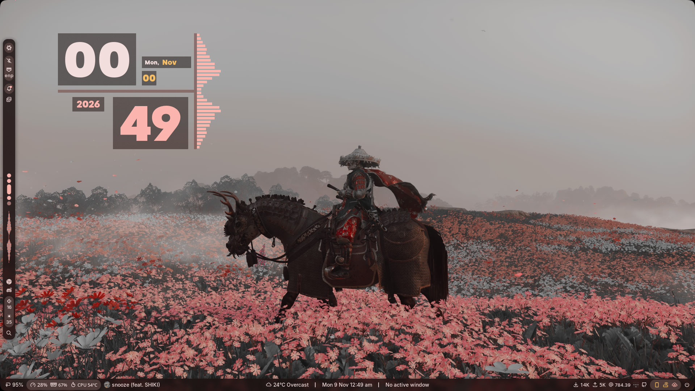
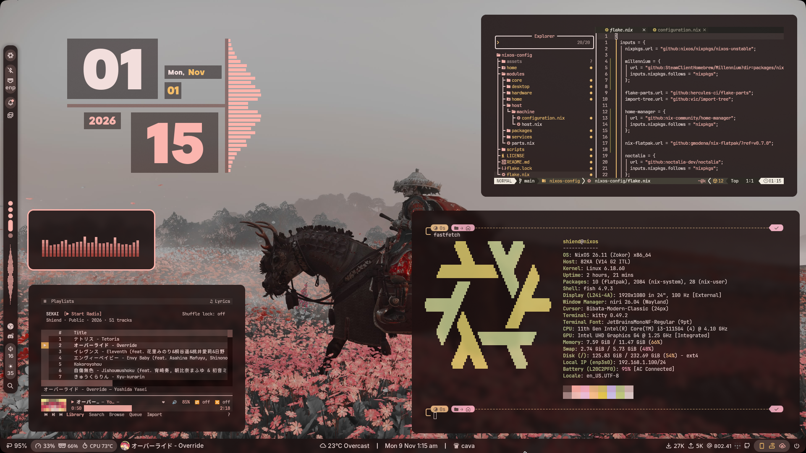
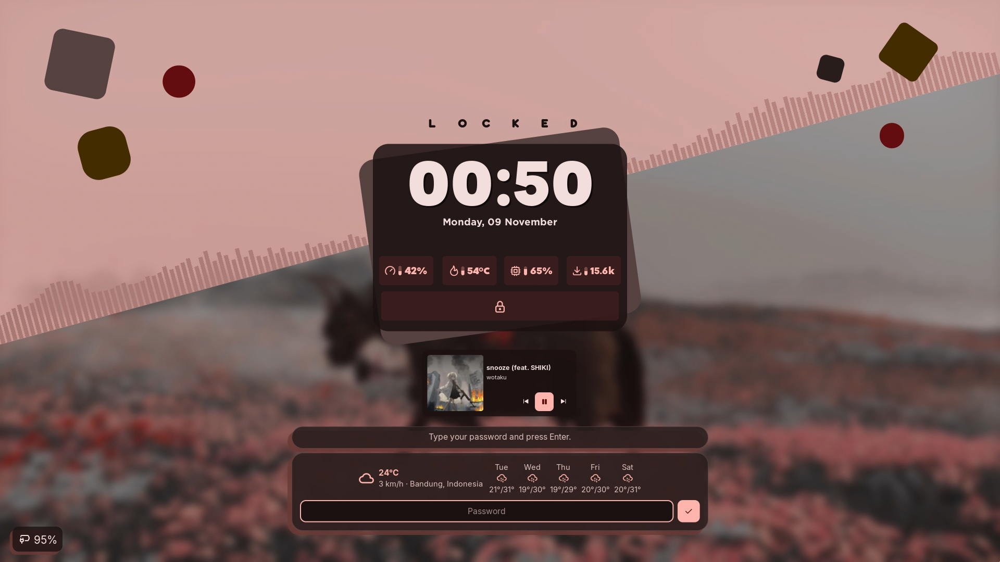
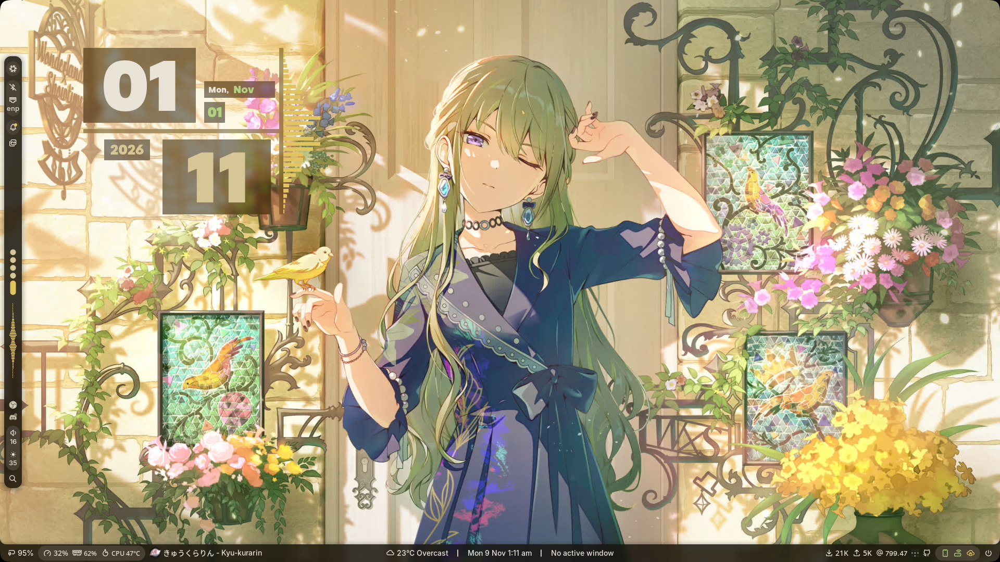
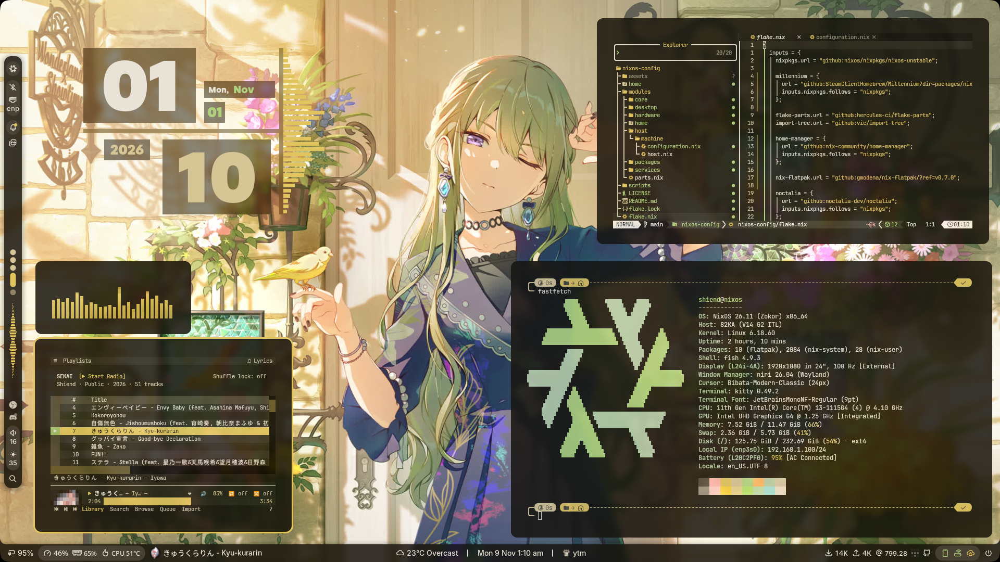
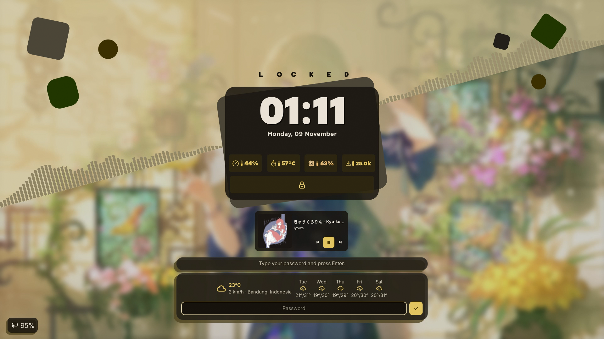

<div align="center">

# ❄ NixOS Configuration

**A personal NixOS desktop built around Niri, Noctalia, and a modular Flake configuration.**

[](https://nixos.org) [](https://github.com/niri-wm/niri) [](https://github.com/noctalia-dev/noctalia) [](https://github.com/nix-community/home-manager) [](LICENSE)

</div>

---

## Preview

<table align="center">
  <tr>
    <td align="center"><br /><sub>Desktop widgets</sub></td>
    <td align="center"><br /><sub>Workspace and applications</sub></td>
  </tr>
  <tr>
    <td align="center"><br /><sub>Lock screen</sub></td>
    <td align="center"><br /><sub>Wallpaper-matched desktop theme</sub></td>
  </tr>
  <tr>
    <td align="center"><br /><sub>Open applications</sub></td>
    <td align="center"><br /><sub>Lock screen theme</sub></td>
  </tr>
</table>

---

## Overview

This repository contains the NixOS configuration for the `shiend` desktop. Nix Flakes and [flake-parts](https://flake.parts/) organize the system modules, while [Home Manager](https://github.com/nix-community/home-manager) handles selected user settings.

## Stack

| Layer              | Configuration                                        |
| ------------------ | ---------------------------------------------------- |
| Operating system   | NixOS unstable                                       |
| Desktop compositor | [Niri](https://github.com/niri-wm/niri)              |
| Desktop shell      | [Noctalia](https://github.com/noctalia-dev/noctalia) |
| Editor             | Neovim                                               |
| Login manager      | SDDM with the Pixie theme                            |
| Terminal           | Kitty                                                |
| Shell and prompt   | Fish and Starship                                    |
| Browser            | Zen Browser                                          |
| File manager       | Dolphin                                              |
| Audio              | PipeWire and WirePlumber                             |
| Gaming             | Steam with GameMode                                  |
| Configuration      | Nix Flakes, flake-parts, and Home Manager            |

## Features

### Desktop

- Niri window, input, layout, keybinding, and window-rule configuration.
- Noctalia panels, widgets, wallpaper controls, and lock screen.
- Wallpaper-based color themes for the desktop and supported applications.
- SDDM login screen with the Pixie theme and custom artwork.

### System

- Separate modules for boot, locale, users, hardware, desktop, packages, and services.
- PipeWire audio, NetworkManager, storage and power settings, and security tools.
- Docker, Flatpak, database services, and OBS Studio recording support.
- Steam, GameMode, desktop applications, multimedia tools, and development toolchains.

### User Settings

Home Manager and activation modules provide the selected Niri, Fish, Kitty, Starship, and Noctalia settings under `home/shiend/`.

## Repository Structure

```text
.
├── flake.nix                 # Flake inputs and outputs
├── flake.lock                # Locked flake input revisions
├── assets/
│   ├── preview/              # Desktop and lock-screen screenshots
│   └── sddm/                 # SDDM background and avatar
├── home/shiend/
│   ├── fish/                 # Fish shell and Starship initialization
│   ├── kitty/                # Kitty terminal settings
│   ├── niri/                 # Niri compositor configuration
│   ├── noctalia/             # Noctalia shell settings
│   └── starship/             # Starship prompt theme
├── modules/
│   ├── core/                 # Boot, locale, Nix, and users
│   ├── desktop/              # Niri, Noctalia, themes, and recorder
│   ├── hardware/             # Machine hardware settings
│   ├── home/                 # Home Manager integration
│   ├── host/                 # Host configuration
│   ├── packages/             # System packages and package overrides
│   └── services/             # System services
└── scripts/
    └── sync.sh               # Sync selected live settings into the repository
```

## Apply the Configuration

```sh
sudo nixos-rebuild switch --flake /home/shiend/nixos-config#shiend
```

## Sync User Settings

Copy selected live user settings into the repository before committing changes:

```sh
./scripts/sync.sh
```

## License

This repository is licensed under the [MIT License](LICENSE). Third-party files retain their own license notices.
